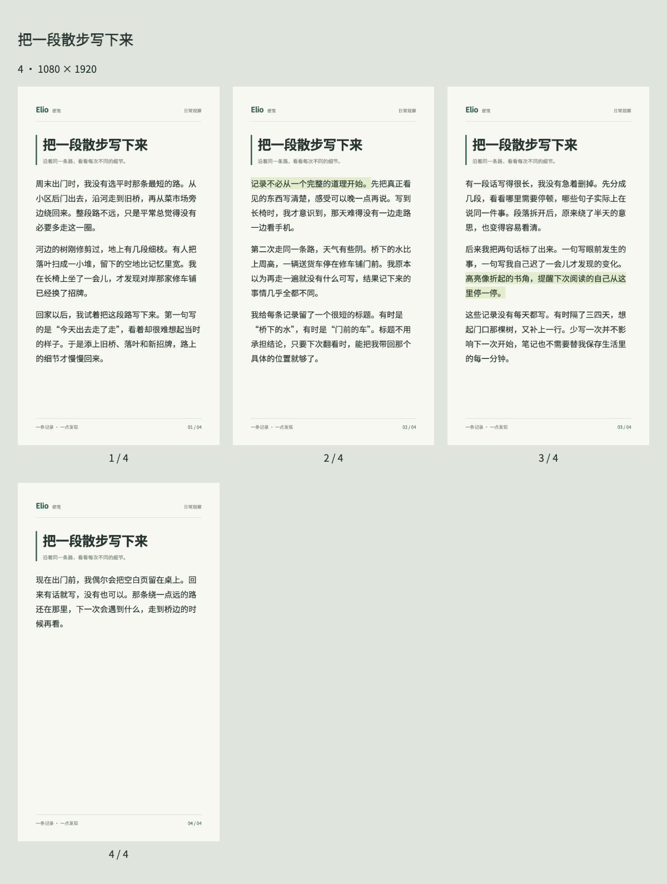

# Elio Memo Cards

把自己的长短文生成独立设计的便笺卡片，输出1080×1920 PNG、可离线打开的HTML与联排预览。

当前版本 `0.1.0-preview.3`：支持长文自动分页、跨页高亮和固定分页检查。不缩字、不裁掉正文。这是首个公开预览候选，当前只验证了下文列出的环境。



## 安装

需要Node.js 24或更高版本。首次安装依赖和Chromium需要网络；生成时只使用本地资源。

```sh
npm ci
npx playwright install chromium --only-shell
npm test
```

## 生成卡片

```sh
npm run generate -- --input examples/zh.json --output output/zh
npm run generate -- --input examples/en.json --output output/en
npm run generate -- --input examples/short.md --output output/short
npm run generate -- --input examples/long-zh.json --output output/long
```

输出目录必须不存在，避免覆盖文件。先看 `index.html` 或 `preview.png` 联排；单页沿用 `card.png/card.html`，多页为 `card-001.png/card-001.html` 等。`render-check.json` 记录页数、源块ID、字符范围、字体和正文/高亮检查。HTML连同同目录的CSS及assets一起移动后仍可使用，不要只移动HTML。

## 文案格式

JSON示例：

```json
{
  "title": "窗边的一天",
  "subtitle": "一条日常记录",
  "language": "zh",
  "body": "打开窗，给桌面透透气。\n\n先记下一件小事。",
  "highlights": ["先记下一件小事。"]
}
```

必填 `title`，并提供 `body` 或 `pages` 其中一种；`language`可选 `zh`（默认）或 `en`。可选纯文本字段为 `subtitle`、`category`、`footer`。

高亮支持正文中唯一出现的短语或长段，包括跨段、跨页延续；缺失、重复或重叠会报错。重复短句请选择更长的唯一片段。高亮的文字逐页核对；换行作为排版间隔保留，不计入可见高亮文字。

Markdown第一行作标题，其后一行空白作为标题分隔符，其余按纯文本处理；不解析Markdown加粗、链接和列表语法。段落以两个换行分隔，段内换行保留。输入换行统一为LF；HTML字符以文字显示，不执行用户脚本。

## 分页模式

默认 `--mode auto`。先尝试放入完整段落，放不下时才按句子、词、字素继续拆分；每次以浏览器实际高度判断。各页保留相同标题与署名，统一回填页码。它是顺序分页，优先保留段落，不做页间密度平衡，因此末页可能留白较多。

已有人工分组时，JSON使用下面的结构替代 `body`：

```json
{
  "title": "两条记录",
  "pages": [
    {"id": "first", "body": "第一条记录。", "highlights": []},
    {"id": "second", "body": "第二条记录。", "highlights": []}
  ]
}
```

`auto`可继续拆分各源块，但不合并源块。`--mode locked`让每个源块对应一页，溢出则停止，不留下最终输出。单独的 `body` 在locked模式下也只允许一页。源块ID必须唯一；高亮写在各源块内部。

页内/页间正文按输入顺序拼接后，必须与换行归一化后的源文完全一致；`start/end`为各源块内的UTF-16偏移，可用于对照JavaScript字符串。

## 检查与限制

```sh
npm run test:render
```

渲染检查覆盖中英文长文、跨页高亮、超长单词、移动后的HTML字体加载、locked溢出拒绝及已有目录保护。已在macOS arm64、Node.js v24.21.0、Playwright 1.62.1和Chromium Headless Shell 151.0.7922.34验证；未验证的平台不作为兼容承诺。

已安装开源Chromium时，可用 `ELIO_CHROMIUM` 指向其可执行文件；默认使用Playwright安装的Chromium。字体固定为本地Noto Sans CJK SC，Regular/Bold，Sans2.004。来源与哈希见 `assets/fonts/SOURCE.json`，OFL许可见 `assets/fonts/LICENSE.txt`。生成时检查实际字体；遇到需要额外系统字体的字符（例如部分emoji）会报错，不静默调用系统字体。

程序不会调用模型API、远程字体或上传服务。生成输出包含用户输入的正文，不应将个人生成目录随源码公开；`output/`已排除在Git之外。此前的静态设计样张仍保留在 `sample.html`。

## 许可证与来源

本项目代码、HTML/CSS、文档和新写示例使用[MIT许可证](LICENSE)。附带的Noto字体保持[SIL OFL 1.1](assets/fonts/LICENSE.txt)，不改为MIT。依赖及运行时来源见[第三方说明](THIRD_PARTY_NOTICES.md)。

用户输入和生成内容的权利仍取决于用户自己的素材；工具许可证不会替用户取得输入素材的授权。

## 反馈问题

请提供操作系统、Node版本、命令、错误信息和一个可公开的最小示例。不要提交账号资料、凭证、私人文章或浏览器会话。
